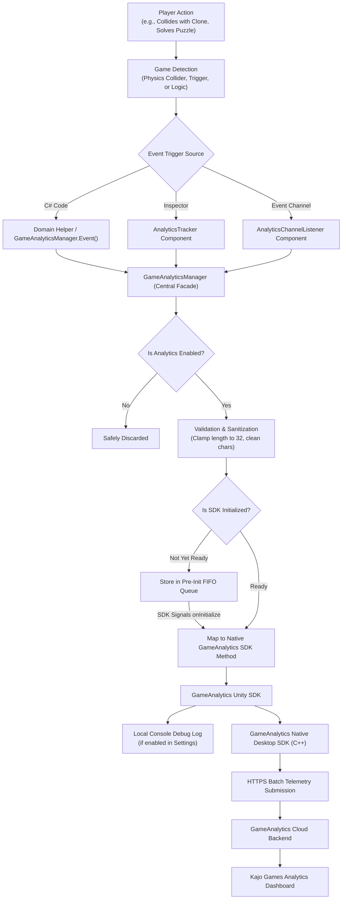
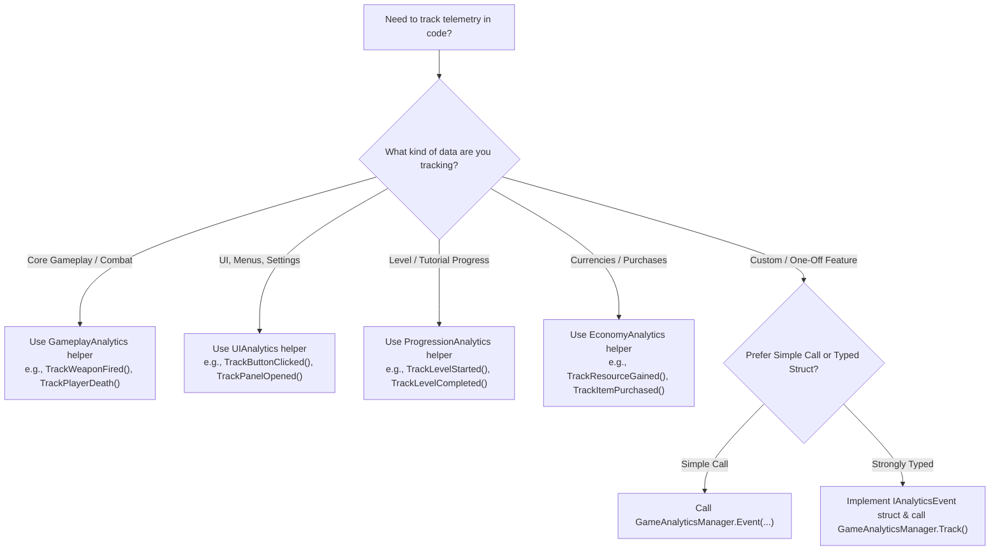
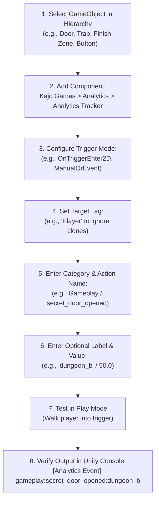
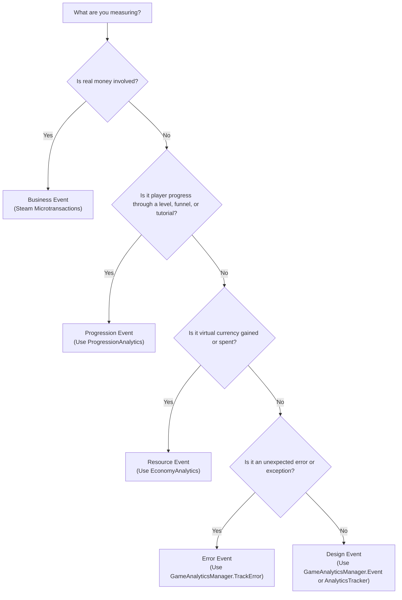

# Copy Paste — Team Analytics Guide
**Studio:** Kajo Games  
**Game:** Copy Paste (PC / Steam)  
**Engine:** Unity 6 (`6000.3.11f1`)  
**SDK:** GameAnalytics Unity SDK `8.3.1` (Native Desktop `5.4.1`)  
**Namespace:** `KajoGames.CopyPaste.Analytics`

---

## Table of Contents
1. [Section A: Welcome and Introduction](#section-a-welcome-and-introduction)
2. [Section B: How the System Works](#section-b-how-the-system-works)
3. [Section C: Quick Start – Add Your First Event](#section-c-quick-start--add-your-first-event)
4. [Section D: For Programmers – Code Integration](#section-d-for-programmers--code-integration)
5. [Section E: For Artists and Non-Programmers – Inspector Integration](#section-e-for-artists-and-non-programmers--inspector-integration)
6. [Section F: Understanding Event Types](#section-f-understanding-event-types)
7. [Section G: Event Naming Rules](#section-g-event-naming-rules)
8. [Section H: Practical Examples for Copy Paste](#section-h-practical-examples-for-copy-paste)
9. [Section I: Debugging and Troubleshooting](#section-i-debugging-and-troubleshooting)
10. [Section J: Team Rules and Best Practices](#section-j-team-rules-and-best-practices)
11. [Section K: Quick Reference](#section-k-quick-reference)

---

## Section A: Welcome and Introduction

Welcome to the internal telemetry guide for **Copy Paste**, developed by **Kajo Games**. 

### What is the Analytics Framework?
The Analytics Framework is an internal system that records player interactions, puzzle completions, combat actions, and technical errors while *Copy Paste* is played. It automatically gathers these data points and dispatches them securely to our analytics cloud provider (**GameAnalytics**).

### A Real-World Analogy: The Flight Data Recorder
Imagine our game as an experimental aircraft on a test flight. 
- When a pilot tests the aircraft, they don't stop mid-air to write notes on every button they push. Instead, a **flight data recorder** ("black box") silently logs altitude, airspeed, button presses, and engine warnings in the background.
- After the flight, the ground engineers review the black box data to discover which maneuvers caused turbulence, which engines overheated, and why an emergency landing occurred.
- In *Copy Paste*, our Analytics Framework is that flight recorder. It quietly logs when players solve a puzzle, when they accidentally collide with an old clone, how many retries a room took, and when a button is clicked—giving us the clear facts we need to polish gameplay.

### Why Kajo Games Uses a Centralized Framework
Instead of calling third-party SDK functions (`GameAnalytics.NewDesignEvent(...)`) directly from individual gameplay scripts, every event passes through our own centralized framework (`GameAnalyticsManager`). 

**Why this matters:**
1. **Safety & Zero Crashes:** GameAnalytics enforces strict naming restrictions (e.g., maximum segment lengths, disallowed characters). Our framework validates and sanitizes all names automatically so invalid strings never break your build.
2. **Pre-Boot Queueing:** If a script fires an event in `Awake()` before the SDK finishes network initialization, our framework holds the event in an internal FIFO queue and flushes it automatically once the SDK is ready.
3. **Editor Simulation:** During Editor development without production API keys, the framework simulates events cleanly in the Unity Console, preventing distracting native DLL popups.
4. **No SDK Boilerplate:** Feature programmers and designers don't need to read GameAnalytics documentation or configure SDK settings—a single intuitive call handles everything.
5. **No-Code Tooling:** Artists and designers can track events directly from the Unity Inspector without writing any C# code.

### What Analytics Helps Us Understand About *Copy Paste*
- **Puzzle Difficulty Spikes:** Are players getting stuck on Level 4 for 25 retries while Level 5 takes only 1 retry?
- **Cloning Mechanics:** How long are player clone recording loops on average? Are players making clones too long or too short?
- **Combat Balance:** How many shots from the machine gun are fired per level? Are players defeating obstacles or relying on brute force?
- **Menu & UI Usability:** Are players discovering multiplayer hosting, or are they getting stuck in connection attempts?
- **Audio & Performance:** What volume levels do players prefer, and are there uncaught exceptions occurring on specific hardware?

---

## Section B: How the System Works

### 1. The Event Lifecycle

The diagram below illustrates the exact path an event takes from the player's physical input to the GameAnalytics web dashboard.


*Figure B.1: The end-to-end lifecycle of an analytics event in Copy Paste.*

---

### 2. Architecture & Class Relationships

```mermaid
classDiagram
    direction TB
    
    class GameAnalyticsManager {
        +Instance: GameAnalyticsManager
        +IsInitialized: bool
        +Event(category, action, ...)
        +Track(IAnalyticsEvent)
        +Track(AnalyticsEventData)
        +TrackProgression(...)
        +TrackResource(...)
        +TrackError(...)
        +SetUserId(string)
        +InitializeSDK()
    }
    
    class AnalyticsSettings {
        +EnableAnalytics: bool
        +AutoInitializeSDK: bool
        +EnableDebugLogging: bool
        +SanitizeEventNames: bool
        +QueueEventsUntilInitialized: bool
        +MaxQueuedEvents: int
    }
    
    class AnalyticsEventData {
        +Category: string
        +Action: string
        +Label: string
        +Value: float?
        +CustomFields: Dictionary
        +ToFormattedEventId(): string
        +Validate(out string): bool
        +SanitizeSegment(string): string
    }
    
    class IAnalyticsEvent {
        <<interface>>
        +Category: AnalyticsEventCategory
        +Action: string
        +Label: string
        +Value: float?
        +CustomFields: IDictionary
        +ToEventData(): AnalyticsEventData
    }
    
    class AnalyticsTracker {
        -triggerOn: TriggerMode
        -triggerOnce: bool
        -category: AnalyticsEventCategory
        -action: string
        -label: string
        +Trigger()
        +TriggerWithValue(float)
    }
    
    class AnalyticsChannelListener {
        -voidChannel: VoidEventChannelSO
        -intChannel: IntEventChannelSO
        -category: AnalyticsEventCategory
        -action: string
    }
    
    class GameplayAnalytics {
        <<static>>
        +TrackWeaponFired(weapon)
        +TrackDamageDealt(weapon, target, dmg)
        +TrackPlayerDeath(cause, level, retries)
        +TrackCloneSpawned(index, duration)
        +TrackPickupCollected(type, count, max)
        +TrackLevelRestart(level, retries)
    }
    
    class UIAnalytics {
        <<static>>
        +TrackButtonClicked(button, screen)
        +TrackPanelOpened(panel)
        +TrackPanelClosed(panel)
        +TrackVolumeChanged(channel, volume)
        +TrackMultiplayerFlow(action)
    }
    
    class ProgressionAnalytics {
        <<static>>
        +TrackLevelStarted(level, attempt)
        +TrackLevelCompleted(level, time, retries, score)
        +TrackLevelFailed(level, reason, time, retry)
        +TrackAllLevelsCompleted(retries, time)
    }
    
    class EconomyAnalytics {
        <<static>>
        +TrackResourceGained(currency, amount, type, id)
        +TrackResourceSpent(currency, amount, type, id)
        +TrackItemPurchased(itemId, cost, currency)
    }
    
    class AnalyticsExtensions {
        <<static>>
        +TrackOnClick(Button, action, screen)
        +TrackOnValueChanged(Slider, setting)
        +TrackAnalyticsEvent(Component, category, action)
    }

    GameAnalyticsManager ..> AnalyticsSettings : Reads config
    GameAnalyticsManager ..> AnalyticsEventData : Dispatches
    AnalyticsTracker ..> GameAnalyticsManager : Calls Track()
    AnalyticsChannelListener ..> GameAnalyticsManager : Calls Event()
    GameplayAnalytics ..> GameAnalyticsManager : Calls Event()
    UIAnalytics ..> GameAnalyticsManager : Calls Event()
    ProgressionAnalytics ..> GameAnalyticsManager : Calls TrackProgression()
    EconomyAnalytics ..> GameAnalyticsManager : Calls TrackResource()
    AnalyticsExtensions ..> GameAnalyticsManager : Calls Event()
    IAnalyticsEvent ..> AnalyticsEventData : Converts to
```


*Figure B.2: System architecture diagram showing the relationships between all runtime classes.*

---

### 3. Explanation of Core Classes

| Class | Location | Responsibility |
| :--- | :--- | :--- |
| **`GameAnalyticsManager`** | `Runtime/GameAnalyticsManager.cs` | The central entry point and singleton facade. Manages SDK auto-boot, event sanitization, pre-init queueing, dispatching to GameAnalytics, and debug logging. |
| **`AnalyticsSettings`** | `Runtime/AnalyticsSettings.cs` | A ScriptableObject holding global controls: master enable toggle, console logging switch, sanitization toggle, and queue size. Saved in `Assets/Resources/Analytics/AnalyticsSettings.asset`. |
| **`AnalyticsEventData`** | `Runtime/AnalyticsEventData.cs` | The standard container representing a validated event. Handles string segmenting, colon formatting, character validation, and length clamping (max 32 chars). |
| **`AnalyticsEventCategory`** | `Runtime/AnalyticsEventCategory.cs` | Strongly-typed enum for top-level event buckets: `Gameplay`, `Combat`, `Progression`, `Economy`, `UI`, `Session`, `Settings`, `Tutorial`, `Error`, `Custom`. |
| **`IAnalyticsEvent`** | `Runtime/IAnalyticsEvent.cs` | Interface for creating strongly-typed event structs/classes with compile-time safety. |
| **`AnalyticsTracker`** | `Runtime/AnalyticsTracker.cs` | Inspector-friendly MonoBehaviour that allows artists and designers to configure and fire events via physics collisions, trigger volumes, button clicks, or lifecycle events. |
| **`AnalyticsChannelListener`** | `Runtime/AnalyticsChannelListener.cs` | Bridges the project's ScriptableObject event channels (`VoidEventChannelSO`, `IntEventChannelSO`) to analytics events without writing code. |
| **`AnalyticsExtensions`** | `Runtime/AnalyticsExtensions.cs` | Fluent extension methods for UI widgets (`Button.TrackOnClick()`, `Slider.TrackOnValueChanged()`) and components. |
| **`GameplayAnalytics`** | `Runtime/Helpers/GameplayAnalytics.cs` | Static helper for domain-specific gameplay actions (weapons, damage, player deaths, cloning cycles, pickups, gates). |
| **`UIAnalytics`** | `Runtime/Helpers/UIAnalytics.cs` | Static helper for menu navigation, button clicks, audio settings changes, and multiplayer relay states. |
| **`ProgressionAnalytics`** | `Runtime/Helpers/ProgressionAnalytics.cs` | Static helper for level start, complete, fail, tutorial checkpoints, and campaign completion mapped to GameAnalytics Progression events. |
| **`EconomyAnalytics`** | `Runtime/Helpers/EconomyAnalytics.cs` | Static helper for in-game currency flows (source/sink), item purchases, and collectible rewards mapped to GameAnalytics Resource events. |

---

## Section C: Quick Start – Add Your First Event

Need to track an event right now? You can do it in less than **60 seconds**.

### For Programmers: 1 Line of Code

Open any C# script where an important action occurs and call `GameAnalyticsManager.Event`:

```csharp
using KajoGames.CopyPaste.Analytics;

public void OnChestOpened()
{
    // That's it! Category, Action, and Label:
    GameAnalyticsManager.Event("gameplay", "chest_opened", "dungeon_gold_chest");
}
```

If the action includes a score, timer, or count, add the number as the 4th parameter:

```csharp
// Sends category, action, label, and numeric value
GameAnalyticsManager.Event("combat", "damage_dealt", "machine_gun", 35.0f);
```

### For Artists & Designers: Zero Code

1. In the Unity Hierarchy, select your GameObject (e.g., a door, a collectible, or a UI Button).
2. Click **Add Component** in the Inspector and select **Kajo Games > Analytics > Analytics Tracker**.
3. Set **Trigger On** to `OnTriggerEnter2D` (or `ManualOrEvent` for a button).
4. Set **Category** to `Gameplay` and **Action** to `secret_room_entered`.
5. Enter **Target Tag** as `Player`.
6. Play the game! Walk into the trigger.

### How to Verify Your Event
When your event fires in Play Mode, open the Unity **Console**. You will immediately see a clean log message formatted like this:

```text
[Analytics Event] gameplay:chest_opened:dungeon_gold_chest
```

If you included a value:
```text
[Analytics Event] combat:damage_dealt:machine_gun | Value: 35
```

---

## Section D: For Programmers – Code Integration


*Figure D.1: Decision flowchart for selecting the right code integration approach.*

---

### 1. Sending a Basic Event
Use this for simple occurrences where you only need to record that an action happened.

```csharp
using KajoGames.CopyPaste.Analytics;

// Formatted hierarchy: category:action
GameAnalyticsManager.Event("combat", "weapon_fired");

// Formatted hierarchy with sub-label: category:action:label
GameAnalyticsManager.Event("combat", "weapon_fired", "machine_gun");

// Using the type-safe category enum:
GameAnalyticsManager.Event(AnalyticsEventCategory.Combat, "weapon_fired", "machine_gun");
```
- **When to use:** Tracking simple triggers, button clicks, or one-off interactions.
- **GA Event Type:** Design Event (`GA_Design.NewEvent`).

---

### 2. Sending an Event with a Numeric Value
Use this when you need a quantity, duration, score, or damage number attached to the event.

```csharp
using KajoGames.CopyPaste.Analytics;

// Track damage dealt
float damageAmount = 45.5f;
GameAnalyticsManager.Event("combat", "damage_dealt", "machine_gun", damageAmount);

// Track time spent solving a puzzle
float solveTime = 12.4f;
GameAnalyticsManager.Event(AnalyticsEventCategory.Gameplay, "puzzle_solved", "gate_blue", solveTime);
```
- **When to use:** Whenever the numerical measurement is crucial for balancing or tuning.
- **GA Event Type:** Design Event with float value (`GA_Design.NewEvent(eventId, value)`).

---

### 3. Sending Custom Parameters (Metadata Fields)
Custom fields attach additional contextual data (e.g., player health, weapon type) for raw data export.

```csharp
using System.Collections.Generic;
using KajoGames.CopyPaste.Analytics;

var metadata = new Dictionary<string, object>
{
    { "remaining_ammo", 14 },
    { "player_speed", 5.2f },
    { "clone_active", true }
};

GameAnalyticsManager.Event("combat", "special_ability", "clone_dash", 1.0f, metadata);
```
- **When to use:** For deep-dive investigations where aggregate charts aren't enough and raw CSV/JSON export is needed.
- **GA Event Type:** Design Event with `customFields` dictionary.

---

### 4. Using the Interface-Based System (`IAnalyticsEvent`)
For complex features where multiple developers collaborate, define a strongly-typed struct. This guarantees compile-time validation so team members cannot misspell event names.

```csharp
using System.Collections.Generic;
using KajoGames.CopyPaste.Analytics;

public struct BossFightEndedEvent : IAnalyticsEvent
{
    public string BossId;
    public float DurationSeconds;
    public int ClonesUsed;
    public bool PlayerWon;

    public AnalyticsEventCategory Category => AnalyticsEventCategory.Combat;
    public string Action => PlayerWon ? "boss_victory" : "boss_defeat";
    public string Label => BossId;
    public float? Value => DurationSeconds;

    public IDictionary<string, object> CustomFields => new Dictionary<string, object>
    {
        { "clones_used", ClonesUsed },
        { "outcome", PlayerWon ? "win" : "loss" }
    };

    public AnalyticsEventData ToEventData() =>
        new AnalyticsEventData(Category, Action, Label, Value, CustomFields);
}

// How to dispatch it in gameplay code:
public void FinishBossFight(string bossName, float duration, int clones, bool won)
{
    GameAnalyticsManager.Track(new BossFightEndedEvent
    {
        BossId = bossName,
        DurationSeconds = duration,
        ClonesUsed = clones,
        PlayerWon = won
    });
}
```

---

### 5. Creating a Feature-Specific Analytics Helper
If you are developing a large new feature (e.g., a "Speedrun Mode" or "Boss Rush"), create a static helper class inside `Assets/Scripts/Analytics/Runtime/Helpers/`:

```csharp
using KajoGames.CopyPaste.Analytics;

namespace KajoGames.CopyPaste.Analytics.Helpers
{
    public static class SpeedrunAnalytics
    {
        public static void TrackSplitReached(string splitName, float splitTime, int retries)
        {
            var fields = new System.Collections.Generic.Dictionary<string, object>
            {
                { "retries", retries }
            };
            GameAnalyticsManager.Event(AnalyticsEventCategory.Progression, "speedrun_split", splitName, splitTime, fields);
        }
    }
}
```

---

### 6. Tracking Gameplay Actions (`GameplayAnalytics`)
Use the existing helper `GameplayAnalytics` for core gameplay mechanics:

```csharp
using KajoGames.CopyPaste.Analytics.Helpers;

// Combat
GameplayAnalytics.TrackWeaponFired("machine_gun");
GameplayAnalytics.TrackDamageDealt("machine_gun", "TargetDummy", 25f);

// Player Deaths
GameplayAnalytics.TrackPlayerDeath("clone_collision", "Level_3", retryCount: 2);

// Cloning System
GameplayAnalytics.TrackCloneSpawned(cloneIndex: 1, recordingDuration: 7.5f);
GameplayAnalytics.TrackCloneReplayFinished(cloneIndex: 1);

// Collectibles & Puzzles
GameplayAnalytics.TrackPickupCollected("coin", currentCount: 3, totalRequired: 5);
GameplayAnalytics.TrackGateOpened("gate_blue_01");
GameplayAnalytics.TrackLevelRestart("Level_2", retryCount: 4);
```

---

### 7. Tracking Progression (`ProgressionAnalytics`)
GameAnalytics features dedicated dashboards for progression funnels (Start, Fail, Complete). Always use `ProgressionAnalytics` for level progression:

```csharp
using KajoGames.CopyPaste.Analytics.Helpers;

// Level started
ProgressionAnalytics.TrackLevelStarted("Level_1", attemptNumber: 1);

// Level completed successfully (records duration, retries, and high score)
ProgressionAnalytics.TrackLevelCompleted("Level_1", timeSeconds: 34.2f, retries: 2, score: 1050);

// Level failed
ProgressionAnalytics.TrackLevelFailed("Level_1", "clone_trap", timeSpentSeconds: 12.8f, retryNumber: 3);

// Full campaign victory
ProgressionAnalytics.TrackAllLevelsCompleted(totalRetries: 18, totalTimeSeconds: 420.5f);
```
- **GA Event Type:** Native Progression Event (`GA_Progression.NewEvent`) + Parallel Design Event for unified dashboard charts.

---

### 8. Tracking Resources & Economy (`EconomyAnalytics`)
Track virtual currency flow (sources and sinks) to balance in-game rewards and costs:

```csharp
using KajoGames.CopyPaste.Analytics.Helpers;

// Player earns coins from a pickup (Source)
EconomyAnalytics.TrackResourceGained("Coins", amount: 10f, itemType: "Pickup", itemId: "GoldCoin");

// Player spends coins on a cosmetic skin (Sink)
EconomyAnalytics.TrackItemPurchased(itemId: "NeonPlayerSkin", cost: 150, currency: "Coins");
```
- **GA Event Type:** Native Resource Event (`GA_Resource.NewEvent`).

---

### 9. Tracking Meaningful Errors (`GameAnalyticsManager.TrackError`)
Track technical or gameplay exceptions in production without crashing the game:

```csharp
using GameAnalyticsSDK;
using KajoGames.CopyPaste.Analytics;

try
{
    LoadLevelData(levelId);
}
catch (System.Exception ex)
{
    // Logs error severity and stack trace safely to GameAnalytics
    GameAnalyticsManager.TrackError(GAErrorSeverity.Critical, $"Level load failed for {levelId}: {ex.Message}");
}
```
- **GA Event Type:** Native Error Event (`GA_Error.NewEvent`).

---

### 10. Disabling or Checking Analytics Status
You can programmatically verify whether the SDK is initialized or toggle event submission:

```csharp
using KajoGames.CopyPaste.Analytics;

// Check initialization
if (GameAnalyticsManager.IsInitialized)
{
    Debug.Log("Analytics SDK is live and connected.");
}

// Temporarily disable analytics (e.g., if player opts out in Privacy Settings)
AnalyticsSettings.Instance.EnableAnalytics = false;
```

---

## Section E: For Artists and Non-Programmers – Inspector Integration

Artists and level designers can instrument entire levels, traps, doors, and UI panels without opening an IDE or writing a single line of C#.


*Figure E.1: Step-by-step workflow for artists and designers using AnalyticsTracker.*

---

### Step-by-Step: Adding an Event in the Inspector

#### 1. Select the GameObject
In the Unity Hierarchy window, click on the object you want to instrument. Examples:
- A secret room trigger volume.
- A hazard trigger (e.g., spikes, laser).
- A UI Button (e.g., "Credits", "Options").

#### 2. Add the Component
In the Inspector window, click **Add Component**, then search for and select:  
**`Kajo Games > Analytics > Analytics Tracker`**

#### 3. Choose the Trigger Mode (`Trigger On`)
Select when the event should fire:
- **`OnTriggerEnter2D`**: Fires when an object enters this 2D trigger collider (recommended for doors, checkpoints, and traps).
- **`OnCollisionEnter2D`**: Fires on physical physics collisions.
- **`ManualOrEvent`**: Fires only when triggered by another component (recommended for UI Button `On Click ()`).
- **`Start` / `Awake` / `OnEnable`**: Fires when the GameObject loads or becomes active.

#### 4. Configure the Filter (`Target Tag`)
If using `OnTriggerEnter2D` or `OnCollisionEnter2D`, set **Target Tag** to `Player`. This ensures the event only fires when the actual player touches it, ignoring background props or bullets.

#### 5. Configure the Event Identity
- **Category**: Pick from the dropdown (`Gameplay`, `Combat`, `UI`, `Tutorial`, etc.).
- **Action**: Enter a short description in lowercase snake_case (e.g., `checkpoint_reached`, `secret_chest_opened`).
- **Label**: (Optional) Add specific location context (e.g., `room_3b`, `top_platform`).
- **Trigger Once**: Check this box if the event should only happen once per run (prevents spamming if the player steps in and out of the trigger volume).

#### 6. (Optional) Add Numeric Values or Custom Fields
- Check **Include Value** and type a number (e.g., `100` for bonus points).
- In the **Custom Fields** list, click `+` to attach extra information (e.g., Key: `difficulty`, Value: `hard`).

---

### Wiring a UI Button (No Code)
To track when a player clicks a UI Button:
1. Select the Button GameObject in the Hierarchy.
2. Add the **`AnalyticsTracker`** component. Set **Trigger On** to `ManualOrEvent`, **Category** to `UI`, and **Action** to `my_button_click`.
3. In the Button's own **Button** component, find the **On Click ()** box at the bottom.
4. Click the small `+` icon to add a new event slot.
5. Drag the same GameObject from the Hierarchy into the object field.
6. Click the dropdown menu currently showing `No Function` and select:  
   **`AnalyticsTracker > Trigger()`**
7. Done! When clicked in game, the event fires automatically.

---

### Using ScriptableObject Channels (`AnalyticsChannelListener`)
*Copy Paste* uses ScriptableObject Event Channels for decoupled gameplay events (like `OnLevelWon.asset` or `OnPickUpCollected.asset`).
1. Select any GameObject in the scene.
2. Add **`Kajo Games > Analytics > Analytics Channel Listener`**.
3. Drag the channel asset into **Void Channel** or **Int Channel**.
4. Set the Category and Action. Whenever the gameplay raises that event channel anywhere in the game, the analytics event will automatically fire!

---

## Section F: Understanding Event Types

GameAnalytics provides specialized event types. Using the correct event type ensures your data is rendered in the correct charts and funnels.

| Event Type | Purpose | Copy Paste Realistic Example | Implemented Framework API |
| :--- | :--- | :--- | :--- |
| **Design Event** | General tracking for player actions, UI clicks, combat events, and mechanics. | Firing a weapon, clicking "Host", opening a gate. | `GameAnalyticsManager.Event("combat", "weapon_fired")` |
| **Progression Event** | Visualizing player drop-off through steps and funnels (Start -> Fail / Complete). | Starting Level 1, dying to a clone, completing Level 12. | `ProgressionAnalytics.TrackLevelCompleted("Level_1", 34f, 2)` |
| **Resource Event** | Analyzing the in-game economy. Tracks virtual currencies gained (Source) or spent (Sink). | Collecting 10 gold coins from a pickup, spending 50 coins on a skin. | `EconomyAnalytics.TrackResourceGained("Coins", 10f, "Pickup", "Gold")` |
| **Error Event** | Logging warnings, exceptions, and critical bugs from players' machines. | Save data corruption, level loading failure. | `GameAnalyticsManager.TrackError(GAErrorSeverity.Critical, msg)` |
| **Business Event** | Real-money in-app transactions (purchases with dollars/cents). | Buying a DLC pack via Steam Store. | `GameAnalytics.NewBusinessEvent(...)` *(Native SDK)* |

---

### Why You Shouldn't Send Everything as a Design Event
While Design Events are flexible, **they do not generate automated funnel charts or currency sinks/sources**:
- If you log level completion as a Design Event only, GameAnalytics cannot automatically compute your game's **Progression Funnel** (which shows where 50% of players quit the game).
- If you log coin rewards as Design Events only, GameAnalytics cannot calculate virtual inflation or the net resource balance.
- **Rule of thumb:** Always use `ProgressionAnalytics` for level progress and `EconomyAnalytics` for currencies. Use Design Events (`GameAnalyticsManager.Event`) for everything else.

---

### Event Type Decision Tree


*Figure F.1: Decision flowchart for selecting the correct GameAnalytics event type.*

---

## Section G: Event Naming Rules

GameAnalytics has strict requirements. Violating these rules will cause events to be rejected by the cloud servers.

### 1. Hierarchy and Format
- Event IDs use colons (`:`) as separators: `category:action:label`
- **Minimum segments:** 1 segment.
- **Maximum segments:** 5 segments (e.g., `part1:part2:part3:part4:part5`).
- **Maximum length:** Each individual segment must be **32 characters or fewer**.
- **Case convention:** Use lowercase snake_case: `player_death`, not `Player Death` or `playerDeath`.

### 2. Permitted Characters
GameAnalytics only allows:
- Letters: `a-z`, `A-Z`
- Numbers: `0-9`
- Punctuation: Underscore (`_`), hyphen (`-`), dot (`.`), space (` `), parentheses (`()`), exclamation mark (`!`), and question mark (`?`).

> [!NOTE]
> Our framework automatically sanitizes invalid characters (such as `/` or `\`) by replacing them with underscores (`_`) and trims segments longer than 32 characters when `SanitizeEventNames` is enabled in `AnalyticsSettings`.

### 3. What to Avoid
- **NEVER generate dynamic event names with player IDs or timestamps:**
  - ❌ BAD: `combat:kill:player_76561198012345678` (creates millions of unique event rows, crashing the dashboard).
  - ✅ GOOD: `combat:kill:clone` with a custom field `{ "target_id", id }`.
- **NEVER track every frame:**
  - ❌ BAD: Tracking `player_moving` inside `Update()`.
  - ✅ GOOD: Tracking `teleport_activated` or `jump_executed`.
- **NEVER send Personal Identifiable Information (PII):**
  - Never send player real names, email addresses, IP addresses, or home directory paths. Steam IDs should only be passed to `GameAnalyticsManager.SetUserId()`.

---

## Section H: Practical Examples for *Copy Paste*

Here are realistic scenarios designed specifically for *Copy Paste*, indicating where and why each event should be triggered:

| Scenario | Event Name / Call | Where to Trigger | Status in Project | Why We Track It |
| :--- | :--- | :--- | :--- | :--- |
| **Player Death by Clone** | `gameplay:player_death:clone_collision` | `PlayerCollision.cs` | **[Implemented]** | Identifies which rooms have the deadliest clone traps. |
| **Pickup Collected** | `gameplay:pickup_collected:pickup` | `PlayerCollision.cs` | **[Implemented]** | Tracks collectible pacing and whether players skip pickups. |
| **All Pickups Collected** | `gameplay:all_pickups_collected:<level>` | `PlayerCollision.cs` | **[Implemented]** | Measures completionist behavior per level. |
| **Level Restarted** | `gameplay:level_restart:<level>` | `GameManager.cs` | **[Implemented]** | Counts user frustration and room difficulty. |
| **Level Started** | `progression:level_start:<level>` | `GameManager.cs` | **[Implemented]** | Creates the start of the progression funnel. |
| **Level Completed** | `progression:level_complete:<level>` | `GameManager.cs` | **[Implemented]** | Logs time taken and final retries to balance level times. |
| **Level Failed** | `progression:level_fail:<level>` | `GameManager.cs` | **[Implemented]** | Records failure drop-offs in the progression funnel. |
| **Campaign Completed** | `progression:all_levels_completed` | `GameManager.cs` | **[Implemented]** | Measures overall game completion rate. |
| **Weapon Fired** | `combat:weapon_fired:machine_gun` | `MachineGun.cs` | **[Implemented]** | Tracks weapon engagement and ammo usage. |
| **Menu Button Clicked** | `ui:button_click:<screen>:<btn>` | `MainMenuManager.cs` | **[Implemented]** | Monitors UI flow and menu interactions. |
| **Panel Navigation** | `ui:panel_opened:<panelName>` | `MainMenuManager.cs` | **[Implemented]** | Discovers which settings/panels players open most. |
| **Multiplayer Flow** | `ui:multiplayer_flow:host_started` | `MainMenuManager.cs` | **[Implemented]** | Diagnoses lobby creation and connection issues. |
| **Audio Volume Changed** | `settings:volume_changed:Music` | `VolumeSettings.cs` | **[Implemented]** | Helps default game audio to player-preferred ranges. |
| **Clone Loop Recorded** | `gameplay:clone_spawned:clone_<idx>` | `CloningSystem.cs` | **[Suggested]** | Measures duration of recorded player loops. |
| **Puzzle Gate Solved** | `gameplay:gate_opened:<gateId>` | `Gate.cs` | **[Suggested]** | Identifies which puzzle gates take longest to open. |
| **Tutorial Completed** | `tutorial:tutorial_complete` | `IntroFlowManager.cs`| **[Suggested]** | Measures tutorial retention and onboarding time. |

---

## Section I: Debugging and Troubleshooting

### 1. Events Not Appearing in the Console
- **Check Master Switch:** Open `Assets/Resources/Analytics/AnalyticsSettings.asset` and ensure **Enable Analytics** and **Enable Debug Logging** are both checked.
- **Check Console Filter:** Ensure your Unity Console does not have the `Info` log category toggled off.

### 2. Events Working in Editor But Not in Steam / Windows Standalone Build
- **Check Game Keys:** In the Unity menu, go to `Tools > Analytics > Select GameAnalytics Settings`. Ensure that under **Platforms**, the **Windows** platform has a valid **Game Key** and **Secret Key**.
- **Check Internet Connectivity:** GameAnalytics requires an active network connection to submit events to the server. Standalone builds queue events offline in SQLite until a connection is re-established.
- **Quit Delay:** When closing a standalone build, the native desktop SDK takes ~1.5 seconds to flush final events. Do not terminate the process forcefully via Task Manager when testing.

### 3. Understanding the 3 Stages of Telemetry Delivery
It is vital to understand that a local console log does **not** guarantee the backend has processed your data:

```
[ Stage 1: Local Framework Validation ]
  ✅ Message logged to Unity Console: "[Analytics Event] combat:weapon_fired:machine_gun"
  → Means our C# framework checked names, lengths, and queued the event.

[ Stage 2: SDK Queueing & Native Submission ]
  ✅ GameAnalytics Native C++ Desktop SDK accepted the event into its local SQLite database.
  → Means the SDK prepared an HTTPS POST request.

[ Stage 3: GameAnalytics Cloud Processing ]
  ✅ GameAnalytics Cloud received the batch and updated aggregate metrics.
  → IMPORTANT: The GameAnalytics web dashboard updates in REAL-TIME on the "Live Feed" tab, 
    but aggregate charts (Explore, Funnels) take 10 to 60 minutes to calculate.
```

---

## Section J: Team Rules and Best Practices

To keep our telemetry reliable and maintainable across all 4 programmers and our artist, everyone on the team agrees to follow these rules:

1. **NEVER call GameAnalytics SDK directly from gameplay code.**  
   Always use `GameAnalyticsManager`, domain helpers (`GameplayAnalytics`, etc.), or `AnalyticsTracker`.
2. **Never change the central framework just to add an event.**  
   The framework is generic. Use existing methods or create a feature helper in `Helpers/`.
3. **Always use lowercase snake_case for action names.**  
   `player_death` ✅ | `Player_Death` ❌ | `player death` ❌.
4. **Never exceed 32 characters per segment.**  
   Keep event segment names concise and descriptive.
5. **Never track actions inside `Update()` or `FixedUpdate()`.**  
   Only track state changes, button presses, trigger entries, and discrete actions.
6. **Never send sensitive player information (PII).**  
   No real names, IP addresses, or file paths.
7. **Document every new event in the catalog.**  
   Whenever you implement a new event, update `Assets/Scripts/Analytics/Documentation/EVENT_CATALOG.md`.
8. **Requesting Framework Changes:**  
   If you need a new core capability (e.g., custom user dimensions, Steam platform overrides), discuss it with the lead software architect before modifying `GameAnalyticsManager.cs`.

---

## Section K: Quick Reference

### 1. Code Cheat Sheet
```csharp
using KajoGames.CopyPaste.Analytics;
using KajoGames.CopyPaste.Analytics.Helpers;

// Simple Event
GameAnalyticsManager.Event("combat", "weapon_fired");

// Event with Value
GameAnalyticsManager.Event("combat", "damage_dealt", "machine_gun", 25.0f);

// Gameplay Helper
GameplayAnalytics.TrackPlayerDeath("clone_collision", "Level_1", retries: 2);

// Progression Helper
ProgressionAnalytics.TrackLevelCompleted("Level_1", timeSeconds: 45.2f, retries: 1, score: 980);

// UI Button Extension
myButton.TrackOnClick("play_game", "main_menu");
```

### 2. Inspector Cheat Sheet
1. Add component: **`Kajo Games > Analytics > Analytics Tracker`**.
2. Select **Trigger On** (`OnTriggerEnter2D` or `ManualOrEvent`).
3. Set **Category** (`Gameplay`) and **Action** (`door_opened`).
4. Set **Target Tag** to `Player`.

### 3. Event Naming Rules
- Format: `category:action:label`
- Max 32 characters per segment. Max 5 segments.
- Permitted characters: `a-z`, `0-9`, `_`, `-`, `.`

### 4. Important Project Paths
- **Settings Asset:** `Assets/Resources/Analytics/AnalyticsSettings.asset`
- **GameAnalytics Credentials:** `Assets/Resources/GameAnalytics/Settings.asset`
- **Menu Shortcuts:** Unity Menu Bar -> `Tools > Analytics`
- **Event Catalog:** `Assets/Scripts/Analytics/Documentation/EVENT_CATALOG.md`

